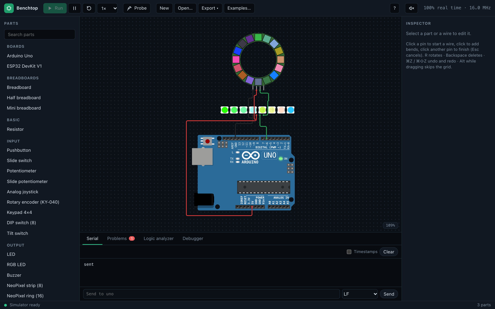
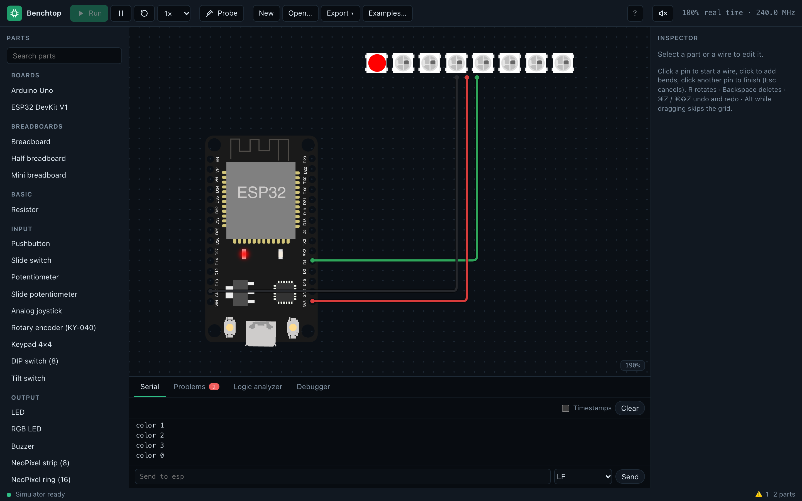
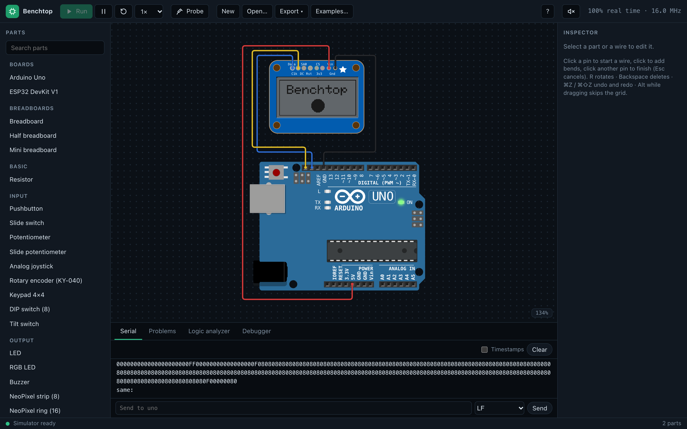
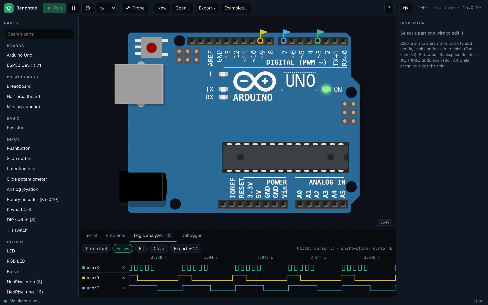

# Benchtop

A fast, visual **Arduino Uno + ESP32** circuit simulator that runs the exact firmware the
Arduino IDE builds — in the browser, so sketches can be debugged and tested without hardware.
Place a board, a breadboard and parts, wire them, drop a `.hex` / `.elf` / `.bin` on the board
(or let the local compile bridge build your sketch on save), and press Run.

> **Status: work in progress.** The Arduino Uno side is complete; the ESP32 boots real
> firmware and runs GPIO, timers, serial, PWM, ADC, I2C, SPI and NeoPixels (see
> [What works](#what-works)). Expect rough edges.



| ESP32 DevKit V1 + NeoPixel strip | Uno + SSD1306 OLED |
|---|---|
|  |  |
| `neopixelWrite` through the emulated RMT peripheral, on the real ESP32 ROM and Arduino-ESP32 firmware | the Adafruit_SSD1306 library drawing over I2C, the panel showing its framebuffer |


*The logic analyzer: probes on three pins of a running Uno — SoftwareSerial at 9600 baud, 490 Hz
PWM and a 1 kHz toggle — with cursors and VCD export.*

## What works

**Arduino Uno, Nano and Mega 2560** (ATmega328P and ATmega2560 via
[avr8js](https://github.com/wokwi/avr8js)): the peripherals their sketches use — GPIO, timers
and PWM, ADC (the Nano's A6/A7, the Mega's 16 inputs), USART (the Mega's four), SPI, TWI (I2C),
EEPROM, interrupts; Mega sketches past 128 KB run. The Nano straddles a breadboard like the real
one.

**ESP32 DevKit V1** — an Xtensa LX6 dual-core emulator written in TypeScript for this project,
running the real `.bin` image Arduino-ESP32 2.0.17 builds, on Espressif's real mask ROM:

- both cores, FreeRTOS, the interrupt matrix and cross-core interrupts;
- the flash cache and MMU (with cache-miss timing) and a direct boot, so no second-stage
  bootloader is needed;
- GPIO, IO_MUX, the GPIO matrix and RTC IO: `digitalWrite`/`digitalRead`, pull-ups,
  `attachInterrupt`;
- timer groups, `esp_timer`, `millis()`/`micros()`, hardware timers, watchdogs, reboots and
  panics (`ESP.restart()`, the interrupt watchdog's Guru Meditation);
- UART0–2 in both directions (the serial monitor), CPU clock changes (`setCpuFrequencyMhz`);
- LEDC PWM (`analogWrite`, `ledcWrite`), ADC1 (`analogRead`, attenuation and resolution);
- I2C (`Wire`, remappable pins) and the SPI2/SPI3 masters, talking to the same parts the Uno
  uses;
- the RMT transmitter, so `neopixelWrite` and `rmtWrite` drive NeoPixels with exact bit timing;
- the DAC on GPIO25/26 (`dacWrite`);
- speed: a predecoded instruction cache (≈ 35–45 million instructions per second on an Apple
  M1 — a blinking sketch runs ~14× faster than real time) and idle skip-ahead, so cores
  waiting in `WAITI` cost almost nothing.

Not on the ESP32 yet: ADC2, the DAC's cosine generator and DMA, touch, I2S, PCNT, CAN, deep
sleep and PSRAM; WiFi and Bluetooth are out of scope.

**The bench** — breadboards (full, half, mini) where parts snap into holes, wires you draw,
and ~40 parts: LEDs, RGB LEDs, buttons, switches, potentiometers, LCD1602/2004 (parallel and
I2C), SSD1306 OLED, an ILI9341 color TFT (SPI), 7-segment displays, LED bar graph, keypad, rotary encoder, joystick, DIP
switches, an IR remote and receiver, PIR/LDR/NTC/sound sensors, DHT22, HC-SR04, DS1307,
MPU-6050, a load cell with an HX711, flame and MQ-2 gas modules, servo, steppers and an A4988
driver (microstepping),
NeoPixel strips/rings/matrices, buzzers, a speaker and a microphone, and a relay. Sound goes
both ways through your computer: a speaker plays the waveform its pin really makes — tone(),
PWM-DAC samples, the ESP32's DAC — and a microphone part can listen to your microphone (only
after you click **Use microphone**; nothing is recorded or stored). A nodal solver gives resistive
networks real voltages (dimmer LEDs through bigger resistors, true ADC readings).

**Environment** — a room around the bench, set up with parts rather than new screens: an
Environment part holds the ambient temperature, humidity, light, sound and gas, and you place
sources in the room — a gas leak, a heater, a candle, a lamp, a sound source, an extractor fan —
and a person or a box that walks or drives a set path. Gas and heat spread and fade on a coarse
grid in the simulation worker, light and sound fall off with distance, and the sensors read
what the room holds where they stand: an MQ-2 smells the leak, a DHT22 or NTC feels the heater,
a photoresistor sees the lamp, a PIR notices the person walking past, an HC-SR04 measures the
box. A heater, lamp or fan can be switched by a pin. A faint heatmap can show any field, and
tests switch sources and set values on a timeline.

**Two boards at once** — an Uno and an ESP32 (or two of either) on one bench, each at its own
clock; a wire between one board's TX and the other's RX (directly or through a resistor
divider) carries the bytes, and a baud mismatch is reported.

**Debugging** — a serial monitor and a serial plotter (numbers or `label:value` lines, graphed
live); a Problems panel (shorts, drive fights, floating inputs, LED, pin and pin-group
overcurrent, unpowered parts, 5 V on 3.3 V pins); a logic analyzer with VCD export; a CPU
debugger for the Uno (breakpoints, stepping, registers, memory, source lines from DWARF); a GDB
remote stub for the Uno; and a headless runner for CI that runs a circuit with scripted inputs
and asserts on serial output and pins.

## Getting started

Requires **Node 24**.

```bash
npm install
npm run dev          # the editor at http://localhost:5173
```

**Examples…** opens 60 ready-to-run circuits, each with its sketch, which you can change and
run again (Basics: blink, button, fade, traffic light, a Simon game, serial echo, a Nano on a
breadboard; Displays: LCDs,
an LCD thermometer, OLED and an OLED clock, a color TFT, 7-segment, bar graph, NeoPixels; Sensors: DHT22,
HC-SR04 and a distance meter, DS1307, MPU-6050, an IR remote, a kitchen scale, a flame alarm, a
gas meter, keypad, rotary encoder; Motors: servo sweep, a
servo knob, a keypad lock, a stepper, an A4988 stepper driver, a relay; Sound: buzzers, a speaker melody, PCM through PWM,
a microphone pitch meter, a VU meter; Environment: a gas alarm with an extractor fan, a PIR
hallway light, a parking sensor, a thermostat; ESP32: blink, serial, button, a PWM fader, NeoPixel, a
rainbow ring, an OLED clock, a color TFT, the DAC, the microphone, an I2C scan; Mega: an LED chaser, four
serial ports, a 16-input analog scanner; Two boards: an Uno ↔ ESP32
chat and relay).

Pick a board from the palette, add parts, wire them, then drop a firmware file onto the board
and press Run — or write the sketch in the app: the **Code** tab edits the board's sketch
(highlighting, find, multiple files), and **Compile & Run** (⌘/Ctrl-Enter) builds it through
the local compile bridge (`npm run bridge`, below) and runs it; errors show on their lines. The
sketch is saved in the project. **Examples…** opens a gallery of ready-to-run circuits (Uno, Nano, Mega and ESP32), and
**Open…** also imports a [Wokwi](https://wokwi.com) `diagram.json` — the circuit comes over,
anything it can't map is listed in the Problems tab, and you drop the firmware on the board.
**Export ▾** saves the project as `.json`, the bench as it looks right now as a PNG (2×) or
an SVG, or copies a **share link** — the whole circuit (and its in-app sketches) packed into the
URL, or just the example's name for an unchanged example.

A production build (`npm start`, below) installs a service worker: once loaded, the app keeps
working offline — the parts and examples you used are cached as you use them. Only compiling
needs the bridge.

### Keyboard shortcuts

Press **?** in the app for this list.

| Mac | Windows / Linux | Does |
|---|---|---|
| ⌘Z | Ctrl+Z | Undo |
| ⇧⌘Z or ⌘Y | Ctrl+Shift+Z or Ctrl+Y | Redo |
| R | R | Rotate the selected parts 90° |
| ⌫ or Delete | Backspace or Delete | Delete the selection (while drawing a wire: remove its last bend) |
| ⇧-click | Shift+click | Add a part to the selection |
| Drag on the bench | Drag on the bench | Select parts in a box |
| ⌥ while dragging | Alt while dragging | Move without snapping to the grid |
| Click a pin | Click a pin | Start a wire; click the bench to add bends, another pin to finish |
| Esc | Esc | Cancel the wire being drawn, leave the probe tool, or clear the selection |
| Scroll | Scroll | Pan the bench |
| ⌘ + scroll or pinch | Ctrl + scroll or pinch | Zoom at the pointer |
| Space + drag | Space + drag | Pan the bench |
| F | F | Fit the whole circuit in view |
| ? | ? | Show this sheet |
| X | X | PCB: the trace tool (click a pad, click bends, click a pad to finish) |
| L | L | PCB: switch the active copper layer (front / back) |
| V | V | PCB: while routing, a via here and continue on the other layer |
| Double-click | Double-click | PCB: end a trace where it is |

In the PCB view, undo, delete, rotate, Esc, F and the pan and zoom gestures work as on the bench.

### The ESP32 ROM (not included)

The ESP32 emulator runs Espressif's mask ROM, which isn't part of this repository. Fetch it once:

```bash
npm run fetch:esp32-rom
```

It downloads `esp-rom-elfs` 20241011 from Espressif's GitHub releases (≈ 3.4 MB), checks it
against two pinned SHA-256 hashes and keeps it in `.cache/esp32-rom`, which git ignores.
Without it, ESP32 boards report "ESP32 ROM not installed" in the Problems panel. The development
server serves the cached ROM to the simulation worker; it is never bundled into a build.

### Compiling sketches (optional)

`npm run bridge` starts a local compile bridge on 127.0.0.1 that uses the `arduino-cli` bundled
with **Arduino IDE 2** (with the `arduino:avr` and `esp32:esp32` 2.0.17 cores installed). The
editor can then open a sketch folder, show compile errors on the board and reload the firmware
when you save. `npm start` builds the app and serves it from the bridge on one origin.

### Headless runs

```bash
npm run bench -- run fixtures/projects/blink-led.json --firmware uno=fixtures/firmware/uno/blink.hex \
  --expect 'serial contains "hello" by 1s' --expect 'pin uno:13 is 1 at 250ms' --duration 2s
npm run bench -- gdb fixtures/projects/debug-demo.json --firmware uno=fixtures/firmware/uno/debug-demo.elf
```

`run` prints a JSON report and exits 0 (pass), 1 (an assertion failed) or 2 (usage or load
error). `gdb` listens on 127.0.0.1:3333 for `avr-gdb` (`target remote :3333`).

### Testing in CI

A test spec (`*.bench.json`) is one run as a file — project, firmware, scripted inputs (button
presses, knob values, text typed into a board's serial port) and expectations, paths relative to
the spec:

```json
{
  "name": "button: D13 lights while D2 is held",
  "project": "../projects/button-pullup.json",
  "firmware": { "uno": "../firmware/uno/button-pullup.hex" },
  "steps": [
    { "at": "100ms", "part": "btn1", "input": { "kind": "press" } },
    { "at": "300ms", "part": "btn1", "input": { "kind": "release" } }
  ],
  "expect": ["pin uno:13 is 1 at 150ms", "pin uno:13 is 0 at 350ms"]
}
```

Expectations can also read what parts show and how pins move: `led led1 is lit at 1s`,
`servo servo angle is 90 ±3 at 2s`, `lcd lcd1 row 0 is "Hello" at 1s`, `pixel ring[0] is
#ff0000 at 1s`, `digits disp show "1234" at 2s`, `pin uno:9 frequency is 490 ±1% between 100ms
and 1s`, `pin uno:9 duty is 25% ±1 between 100ms and 1s`, `serial matches /T=\d+/ by 3s`.
With an environment part, a step can switch or tune a source — `{ "at": "1s", "part": "leak",
"set": { "rate": 5, "on": true } }` — and `env gas at mq2 > 300 at 4s` (or `is 22 ±0.5`; gas,
temperature, humidity, light, sound) reads the room at a part.

`test` runs every spec it finds, in parallel, and writes JUnit XML (which CI systems show as test
results) and a Markdown summary:

```bash
npm run bench -- test fixtures/specs --junit results.xml --markdown summary.md
```

It exits 0 when every spec passes, 1 when an expectation fails and 2 when a spec can't run.

You can also record a test by using the app: **Record test** in the toolbar restarts the bench
and records every button press, knob turn, keypad key and serial input at its exact simulated
time; **Stop** proposes expectations from where it ended (serial lines, lit LEDs, LCD rows,
servo angles) — tick the ones you want, name the firmware files, and download the spec. Every
example in the gallery has such a spec in `fixtures/specs/examples/`. In a
GitHub Actions job, after `npm ci`, compiling your sketches with `arduino-cli` and (for ESP32
boards) `npm run fetch:esp32-rom -- --yes`:

```yaml
- run: npm run bench -- test specs --junit results.xml --markdown summary.md
- if: always()
  run: cat summary.md >> "$GITHUB_STEP_SUMMARY"
```

### From breadboard to PCB

The circuit on the bench can become a two-layer through-hole board: **PCB** in the toolbar
shows it (and **Bench** goes back). Breadboards and jumper wires
turn into nets; boards become their headers (an Uno or a Mega as a shield, a Nano or an ESP32
DevKit as two rows); modules become the header rows they plug into; resistors, LEDs and buttons
get standard footprints. Lay the parts out, draw traces on the front and back with vias between
them, and the design rule check flags clearances, shorts, thin traces, small drills, copper too
near the edge and connections still missing (listed in the Problems tab; a click shows the
spot). **Export ▾ → PCB fabrication files** downloads what a PCB fab asks for — Gerber
RS-274X (copper, solder mask, silkscreen, outline), an Excellon drill file and a BOM — plus a
KiCad netlist with a matching footprint library, to carry on in KiCad.

```bash
npm run bench -- pcb fixtures/projects/blink-led.json --pcb fixtures/pcb/blink.pcb.json --out fab --drc
```

writes the files into `fab/` (or one ZIP with `--zip`); without `--pcb` it seeds a layout from
the bench. With `--drc` it exits 1 when the check finds an error.

## How it's built

TypeScript 7 (strict), npm workspaces, Vite + Preact for the editor, Vitest for tests. The
simulation runs in a Web Worker; the UI only renders. Packages:

| Package | What |
|---|---|
| `packages/core` | contracts, netlist, switch-level signal resolution, analog solver, scheduler, the `Bench`, firmware loaders (Intel HEX, ELF, DWARF lines), problem checks, probes |
| `packages/avr` | the AVR `Mcu`s over avr8js (ATmega328P: Uno, Nano; ATmega2560: Mega), their debugger and the GDB protocol |
| `packages/esp32` | the Xtensa LX6 core, decoder and objdump-exact disassembler, the ESP32 SoC and its peripherals, direct boot, the ESP32 `Mcu` |
| `packages/parts` | the part catalog: pins, buses, behavior models |
| `apps/web` | the editor, part views, the simulation worker |
| `apps/bridge` | the local compile bridge (Node, no dependencies) |
| `apps/cli` | the headless runner, the test-suite runner and the GDB server (Node) |

[docs/ARCHITECTURE.md](docs/ARCHITECTURE.md) explains the design in depth: the time model, the
signal resolver, how the ESP32 boots and keeps time, and where the emulation approximates.

### Development

```bash
npm run verify       # typecheck + tests + production build — the gate for every change
npm run fixtures     # rebuild the test firmware with your local arduino-cli (see fixtures/README.md)
node scripts/esp32-trace.ts serial-hello --until app_main   # the ESP32 boot debugger
npm run screenshots  # refresh docs/images from the running dev server (needs Chrome, Chromium, Edge or Brave)
```

The tests run real compiled firmware (`fixtures/`) and assert on pins, bytes and timing. The
ESP32 tests need the ROM (`npm run fetch:esp32-rom`).

## Accuracy and limitations

Benchtop aims for behavior you can trust while debugging, not cycle accuracy everywhere. The
Uno is cycle-accurate through avr8js. The ESP32 counts one cycle per instruction plus flash
cache stalls, interleaves its two cores in ~1 µs slices, and models only the peripherals listed
above; registers without a model read their documented reset values and are reported. Analog
behavior comes from a resistive-network solver with piecewise-linear diodes (networks of up to
256 nets — 100 LEDs with their resistors on one pin solve, and the pin sags under them as a real
one would); a larger network keeps digital values instead, and the Problems panel says so. Timing claims are
backed by tests (for example, ESP32 blink toggles every 500.000 ms of simulated time).
[docs/ARCHITECTURE.md](docs/ARCHITECTURE.md) lists the known approximations.

## Credits

- [avr8js](https://github.com/wokwi/avr8js) (MIT) — the ATmega328P core behind the Uno.
- [@wokwi/elements](https://github.com/wokwi/wokwi-elements) (MIT) — the part drawings, and
  the pin positions the part catalog copies from them.
- [esp-rom-elfs](https://github.com/espressif/esp-rom-elfs) (Apache-2.0) — Espressif's ESP32
  ROM, which you download yourself (above).

## Disclosures

- **Not affiliated** with Arduino, Espressif Systems or Wokwi. Arduino, ESP32 and other names
  are trademarks of their owners, used only to say what this software emulates.
- **Clean-room toward other simulators.** No code or assets are taken from closed-source
  simulators. Hardware behavior comes from datasheets, Espressif's Technical Reference Manual,
  ESP-IDF headers and compiled firmware. Open-source code and data are used under their
  licenses — see [THIRD_PARTY_NOTICES.md](THIRD_PARTY_NOTICES.md).
- **The ESP32 ROM** is Espressif's (Apache-2.0). You download it yourself; this repository
  doesn't redistribute it.
- **Test firmware** in `fixtures/firmware/` is compiled from the sketches in
  `fixtures/sketches/` and contains code from the Arduino cores, ESP-IDF and Arduino libraries
  under their own licenses (LGPL-2.1, Apache-2.0, BSD, MIT); details and where to get their
  sources are in [THIRD_PARTY_NOTICES.md](THIRD_PARTY_NOTICES.md).

## License

MIT — see [LICENSE](LICENSE). Third-party material keeps its own license
([THIRD_PARTY_NOTICES.md](THIRD_PARTY_NOTICES.md)).
